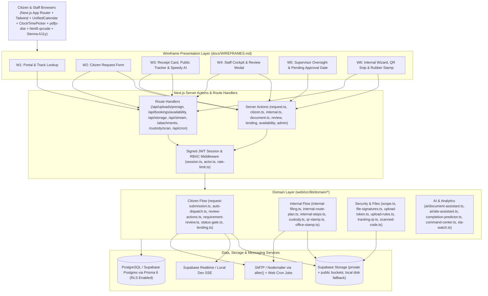
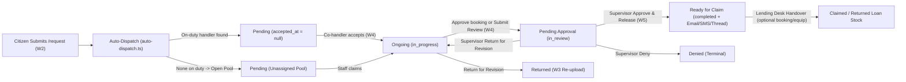

# SPeED TraQR — System Design & Architecture Guide

**SPeED TraQR** (San Pedro Electronic Document & Service Tracking QR System) is a web platform for the **City Government of San Pedro, Laguna**, currently tailored for the **City Tourism, Culture and Arts Office (CTCAO)** alongside inter-office internal routing (including **Action Mamamayan (`AM`)** and the **Office of the Mayor (`OM`)**).

This document reflects the live **Next.js 15 + TypeScript + Prisma 6 + PostgreSQL / Supabase + Vercel** implementation (including pre-defense security, validation, upload, QR, and UI updates) and connects directly to the screen wireframes in [WIREFRAMES.md](./WIREFRAMES.md).

---

## 1. System Overview & Civic Mission

Citizens, barangays, and partner organizations submit requests online with **no account or login required** and immediately receive a QR-coded tracking number:

- **Citizen / External requests:** `SPD-YYYYMMDD-XXXXXX` (6 characters drawn from an unambiguous 30-symbol base-32 alphabet excluding `0/1/I/L/O/U`).
- **Internal office-to-office requests:** `INT-YYYYMMDD-XXXXXX`.

Key operational goals:
1. **Transparency without accounts for citizens:** Track live request progress, preview public instructions, ask questions via the scoped **Speedy** AI assistant, or upload supporting documents/revisions after verifying contact details.
2. **Accountability inside City Hall:** Auto-dispatch requests round-robin to configured on-duty handlers (`request_type_handlers`), enforce preview-before-verify requirement checks, gate final approval behind Supervisors, and enforce 2-hour unaccepted escalation + SLA alerts.
3. **Bridging paper & digital signatures:** HMAC-signed `SPDQR1:` QR payloads, server-side PDF/image QR stamping with graphics-state isolation, screen-snip/camera/image multi-pass scanning, and pen-blue digital `RECEIVED` rubber stamps carrying frozen e-signatures.

---

## 2. System Architecture & Connected UI Layers

Every wireframe screen (`W1`–`W6` in [WIREFRAMES.md](./WIREFRAMES.md)) connects through Next.js App Router pages, Server Actions (`web/src/app/actions/*`), and Route Handlers into pure domain business rules (`web/src/lib/domain/*`) backed by PostgreSQL (Prisma 6) and Supabase Storage / Realtime:

---

## 3. Roles, Permissions & Access Scoping

Authorization uses Spatie-shaped RBAC tables (`roles`, `permissions`, `model_has_roles`, `model_type = 'App\\Models\\User'`) resolved via `currentActor()` (`web/src/lib/auth/actor.ts`):

| Role | Scope & Landing Page | Capabilities |
|---|---|---|
| **`staff`** | Department-scoped (`/my-dashboard`) | Accept/claim citizen requests, open and verify requirement uploads, approve facility/equipment reservations, submit work for Supervisor review (`Pending Approval`), manage walk-in inventory desk, receive paper/soft internal hops. |
| **`Supervisor`** | Department-scoped (`/dashboard`) | Everything staff can do in their office plus: approve/deny requests in `Pending Approval` (releasing Ready for Claim notices), reassign work across on-duty staff, override staff On Duty / On Leave, toggle request types/catalog, approve/return/deny/stamp internal hops. |
| **`super_admin`** | Org-wide (`/admin` / Analytics Command Center) | Unrestricted cross-department oversight (`manage system`), user/department administration, full audit log, analytics command center. |
| **`Clerk`** | Action Mamamayan only (`/requests`) | Dedicated one-person account (`isClerk()`) handling internal requests (`scan documents`, `act on internal requests`, `create internal requests`) with no citizen dashboard. |

### Defense-in-Depth Attachment & Document Scoping (`web/src/lib/domain/scope.ts`)
- **`documentScope(actor)`** constrains all database list queries (Look Up, History, Reports, Dashboards) by office (`department_id` or `involvingOffice()` for `INT-`).
- **`canAccessDocument(subject, actor)`** enforces matching strict boundaries on private file routes (`/attachments/[attachment]` and `/documents/[document]/requirements/[requirement]/file`) and custody actions:
  - Internal (`INT-`) files require `manage system`, creator/assignee, or a matching `requesting_department_id` / `involved_department_ids` hop (or unassigned-office Supervisor).
  - Citizen (`SPD-`) files deny cross-department Supervisors; allow same-office Supervisors, unrouted triage intakes, assigned/unclaimed office pool staff, and configured unaccepted co-handlers (`accepted_at === null`) inside the same office.

---

## 4. Citizen Request Lifecycle (`SPD-`)

### 4.1 Stages & Transitions (`web/src/lib/domain/document-status.ts`)

| Internal Status | Staff Label | Citizen Label (`CITIZEN_LABELS`) | SLA Budget |
|---|---|---|---|
| `pending` | Pending | Received & Queued | 24h |
| `in_progress` | Ongoing | Processing | 72h |
| `in_review` | Pending Approval | Final Quality Check | 48h |
| `completed` | Ready for Claim *(or Completed for services)* | Ready for Pickup / Claiming | Terminal |
| `returned` | Returned | Needs Your Attention | Paused / Returned |
| `on_hold` | On Hold | On Hold | Paused |
| `denied` | Denied | Unable to Fulfill | Terminal |

*(Retired legacy `'approved'` rows normalize cleanly to `'completed'` / Ready for Claim.)*

### 4.2 Intake, Auto-Dispatch & Conflict Prevention
1. **Form & Client Validation (`W2`):** `RequestForm` validates identity, Philippine contact numbers (`09XXXXXXXXX`), RA 10173 consent, `detailsLabel`, service/equipment counts (`<= serviceableUnits`), unified calendar booking dates (`UnifiedCalendar` disabling booked dates), analog start/end times (`ClockTimePickerField`), and up to 10 MB requirement files before submitting.
2. **Server Authority (`request.ts`, `request-submission.ts`):** Re-validates inputs, runs `resolveSchedule()`, acquires PostgreSQL transaction advisory locks (`lending.lockResourceBookings`) for facility bookings to prevent concurrent double-bookings, snapshots `document_requirements`, generates `SPDQR1:` QR PNG, and runs `resolveAutoDispatch()` round-robin across active on-duty `request_type_handlers` (`is_available = true`), falling back to the department Open Pool if everyone is On Leave.
3. **Co-Handler Visibility & Reassignment:** All configured handlers for a type see unaccepted (`accepted_at: null`) requests under `My Active` (`my-dashboard`) and can atomically claim/accept; switching to **On Leave** or exceeding the 2-hour daily cron sweep (`/api/cron/reclaim-unaccepted` at 10:00 Manila) automatically rotates unaccepted assignments to another on-duty handler or back to the pool.
4. **Per-Type Claiming Date Rules (`request-kinds.ts`):**
   - **Facilities (`City Plaza Reservation`, `Gateway Park Reservation`):** Claiming date is optional and booked slots are greyed out/struck through on the claim calendar.
   - **Equipment / Physical Permits:** Claiming date required before clearance.
   - **Non-pickup Services (`Lei Making`, `Layout Request`, `Social Media Posting`, `Events Set-up`, `Program Assistance`, `Other Venue Request`):** Claiming date UI hidden.
5. **Requirement Checks & Supervisor Clearance:** Staff must open an uploaded file (`?open=1` on the file route) before marking it verified (`requirement-review.ts`). Approving a facility reservation or clicking **Submit for Supervisor Review** transitions the request to `Pending Approval`; only a Supervisor (`approveClearance`) can release it to `Ready for Claim`, notifying the citizen by email, SMS (if configured), and public thread message.

### 4.3 CTCAO Default Request Catalog (`web/scripts/seed-tourism.mjs`)

| Request Type | Kind | Default Handlers (`request_type_handlers`) | Extra Question |
|---|---|---|---|
| **City Plaza Reservation** | `booking` | Ana Cruz, Bea Santiago *(round-robin)* | — |
| **Gateway Park Reservation** | `booking` | Ana Cruz, Bea Santiago *(round-robin)* | — |
| **Other Venue Request** | `service` | Ana Cruz, Bea Santiago *(round-robin)* | Which venue? |
| **Events Set-up** | `service` | Mark Dizon | Venue of the event |
| **Spider Banner Borrowing** | `equipment` | Ana Cruz | — |
| **Philippine Flag Borrowing** | `equipment` | Ana Cruz | — |
| **Philippine Flag Requisition** | `service` | Ana Cruz | Size of the flag |
| **San Pedro Seal Flag Borrowing** | `equipment` | Ana Cruz | — |
| **Lei Making** | `service` | Mark Dizon | — |
| **Layout Request** | `service` | Joy Navarro | Size (e.g. 3 x 6 ft tarpaulin) |
| **Social Media Posting** | `service` | Kevin Ramos | — |
| **Program Assistance** | `service` | Mark Dizon | Name of the program or event |

*(Configured and editable live by Supervisors / Super Admins on `/admin/request-types`.)*

---

## 5. Internal Office-to-Office Workflow (`INT-`)

Internal requests (`internal-filing.ts`, `internal-route-plan.ts`, `internal-steps.ts`, `custody.ts`) support two routing modes selected at filing (`W6`):
- **`ROUTE_THROUGH` (Default):** Queues mandatory hops `['AM', 'OM']` (`Action Mamamayan` → `Office of the Mayor`, skipping `AM` if `AM` files). When `OM` approves, it chooses the destination office (and named recipient for soft copies).
- **`ROUTE_DIRECT`:** Queues only the chosen destination office (and recipient if soft copy).

### Paper-to-Digital QR & Stamp Pipeline
1. **Server-Side QR Stamping (`web/src/lib/domain/qr-stamp.ts`):** Produces `{tracking}-qr-stamped.{ext}` alongside the untouched original upload. On PDFs, it flattens AcroForm fields, strips overlapping non-Link annotations (`/Annots`), wraps existing content streams in `q ... Q` (`pushGraphicsState`/`popGraphicsState`) so unbalanced transforms/clipping paths cannot slice white lines over the QR, respects `CropBox`, and embeds an opaque RGB QR PNG (`#ffffff` backing).
2. **Multi-Pass Client Scanning (`web/src/lib/client/speed-qr.ts`):** Camera scanning serializes async `Html5Qrcode` start/stop calls with desktop/rear-camera fallback; file/screen-snip decoding (`ScanDialog`, `QrTile` `pdfjs-dist` `<canvas>` rendered at `1800px`) uses multi-point cropping, quiet-zone padding, and 4 decoding passes (`BarcodeDetector` → QR-focused ZXing → quiet-zone canvas → binarized canvas).
3. **Digital `RECEIVED` Rubber Stamp (`web/src/lib/domain/office-stamp.ts`):** Optional drag-and-drop placement on approval stamps `{tracking}-office-stamp-{stepId}-{CODE}.{ext}` in pen blue with the approver's frozen e-signature, name, Manila date, and time.

---

## 6. Data Model (`web/prisma/schema.prisma`)

All timestamps in domain tables use **naive Asia/Manila wall-clock** (`src/lib/time.ts`), while `rate_limits` uses Postgres `timestamptz`. Every table enables Postgres Row Level Security (`ENABLE ROW LEVEL SECURITY`).

| Table | Purpose | Key Columns |
|---|---|---|
| `documents` | Citizen & internal requests | `tracking_number`, `origin` (`external`/`internal`), `document_type`, `status`, `department_id`, `requesting_department_id`, `assigned_to`, `accepted_at`, `needed_by`, `claimed_at`, `details`, `requester_office`, `qr_code_path` |
| `departments` | City offices (`CTCAO`, `AM`, `OM`, `CADM`, …) | `code`, `name`, `is_active` |
| `users` | Staff, Supervisors, Super Admins, Clerk | `name`, `email`, `password` (bcrypt), `department_id`, `is_active`, `is_available`, `avatar_path`, `signature_path` |
| `request_types` / `request_type_handlers` / `request_type_requirements` | Catalog definitions, round-robin handlers, checklists | `kind`, `resource_id`, `details_label`, `sort_order`, `is_mandatory` |
| `document_requirements` | Per-ticket requirement checklist & verification state | `uploaded_file_path`, `review_status`, `opened_at/by`, `verified_at/by` |
| `document_attachments` | Private citizen/staff uploads, stamped QR copies, office stamps | `file_path` (random 40-char hex / versioned marker), `sort_order` |
| `document_comments` | Threaded timeline feed (`public` vs `internal` notes, system events) | `author_type`, `visibility`, `parent_id`, `body` |
| `request_steps` | Internal endorsement hops & frozen approver signature snapshots | `step_order`, `department_id`, `recipient_id`, `status`, `signature_path`, `stamp_path` |
| `document_custody_events` | Physical folder scans (`scan`, `image`, `screen`, `manual`) | `user_id`, `capture_method`, `override_reason` |
| `resources` / `bookings` | Venues (facilities) & lent items (equipment) reservations | `kind`, `total_quantity`, `damaged_quantity`, `starts_at`, `ends_at`, `status` |
| `notifications` / `activity_log` | User bell notifications & immutable audit history | `data` (JSON), `read_at`, `subject_type`, `causer_id` |
| `rate_limits` | Postgres fixed-window counters across Vercel serverless instances | `key`, `hits`, `reset_at` (`timestamptz`) |

---

## 7. Security, Privacy & Upload Architecture

- **Authentication & Sessions (`src/lib/auth/session.ts`):** `HS256` signed JWT cookies (`httpOnly`, `sameSite: 'lax'`), strict server action re-checks on permissions/department scope, `Cache-Control: no-store` on authenticated responses (`middleware.ts`).
- **Throttling & CSRF/Origin Defense (`src/lib/rate-limit.ts`):** Postgres fixed-window counters (`login`, `citizenSubmit`, `speedyAsk`, `verifyContact`, `citizenUpload`, `publicLookup`, etc.) with an in-memory fallback Map if Postgres is unreachable; `crossSite()` inspects `Sec-Fetch-Site`, `Origin`, and `Referer`.
- **Uploads & 10 MB Direct-to-Supabase Bypass (`src/app/api/uploads/presign/route.ts`, `upload-token.ts`, `file-signatures.ts`):**
  - Client forms check extension/size immediately (`upload-rules.ts`), then request a short-lived signed upload URL (`createSignedPrivateUploadUrl`) when Supabase is configured, uploading directly to Supabase `private` storage so files up to 10 MB never hit Vercel's 4.5 MB function limit (falling back transparently to Server Action `FormData` locally).
  - Server actions validate both `uploadRules.check()` and leading magic bytes (`file-signatures.ts`) and reject/delete mismatched or executable binaries (`MZ`, `ELF`, `Mach-O`).
- **Private Disk & Headers (`next.config.ts`, `file-response.ts`, `csv.ts`):** Security headers, `Content-Security-Policy` sandboxing inline SVG previews, CSV formula-prefix neutralization (`=`, `+`, `-`, `@`), `SPDQR1:` HMAC-SHA256 QR signatures (`tracking-qr.ts`), contact masking on public pages, and **staff anonymity** on all citizen surfaces.

---

## 8. Innovation Features & Scheduled Jobs

- **Speedy AI Assistant (`web/src/lib/domain/ai/`):** Grounded single-document RAG + public catalog FAQ assistant (`document-assistant.ts`, `site-assistant.ts`) with strict privacy isolation and deterministic fallback if no LLM key is set.
- **Predictive Turnaround ETA (`completion-predictor.ts`):** Computes median historical completion days with confidence intervals for requested services.
- **Real-Time Status & Auth Verification (`lib/realtime.ts`, `/verify/[trackingNumber]`):** Relays minimal tracking update triggers over Supabase Realtime (or local SSE) without exposing PII in event payloads.
- **Scheduled Maintenance (`vercel.json`, `/api/cron/[job]`):** Constant-time `CRON_SECRET` Bearer auth runs daily SLA/overdue sweeps (07:00 Manila) and 2-hour unaccepted reassignment sweeps (10:00 Manila).

---

## 9. Where to Look in the Code

| Area | Primary Files |
|---|---|
| Screen wireframes & UI-to-backend mapping | [WIREFRAMES.md](./WIREFRAMES.md) |
| Lifecycle stages & SLA budgets | `web/src/lib/domain/document-status.ts`, `web/src/lib/domain/status-gate.ts` |
| Citizen submission & client validation | `web/src/app/actions/request.ts`, `web/src/lib/domain/request-submission.ts`, `web/src/lib/client/citizen-request-validation.ts` |
| Auto-dispatch, staff review & bookings | `web/src/lib/domain/auto-dispatch.ts`, `web/src/lib/domain/review-actions.ts`, `web/src/lib/domain/lending.ts` |
| Internal requests, QR & rubber stamps | `web/src/lib/domain/internal-filing.ts`, `web/src/lib/domain/qr-stamp.ts`, `web/src/lib/domain/office-stamp.ts`, `web/src/lib/domain/custody.ts` |
| Security, scoping, uploads & rate limits | `web/src/lib/domain/scope.ts`, `web/src/lib/rate-limit.ts`, `web/src/lib/domain/file-signatures.ts`, `web/src/lib/domain/upload-token.ts` |
| Shared Pickers & QR Scanner | `web/src/components/unified-calendar.tsx`, `web/src/components/clock-time-picker-field.tsx`, `web/src/lib/client/speed-qr.ts` |
| Database schema & seeds | `web/prisma/schema.prisma`, `web/scripts/seed-tourism.mjs`, `web/scripts/seed-departments.mjs` |
