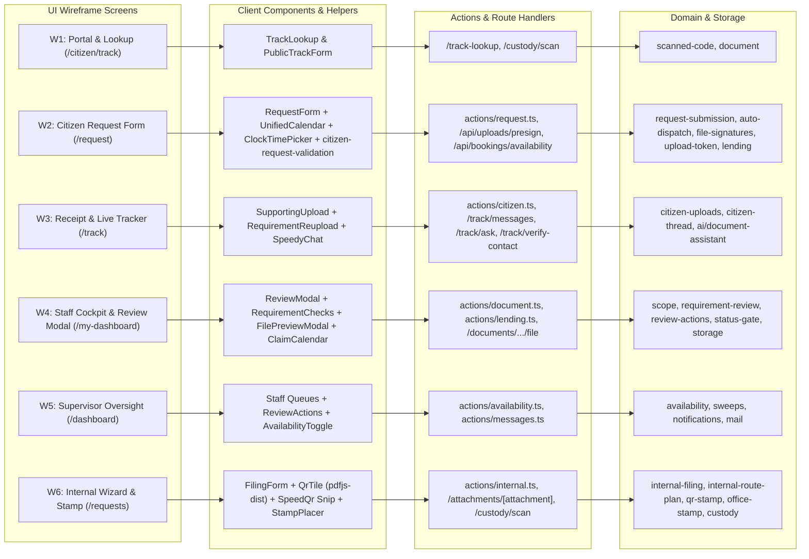

# SPeED TraQR — Connected UI Wireframes & Traceability Guide

This document defines the screen wireframes (`W1`–`W6`) for **SPeED TraQR** and connects every UI region directly to the components, Server Actions, API Route Handlers, Domain Modules, and Data Stores documented in [SYSTEM_DESIGN.md](./SYSTEM_DESIGN.md).

---

## 1. Wireframe-to-System-Diagram Connection Map



---

## 2. Screen Wireframes (`W1`–`W6`)

### W1 — Citizen Track Lookup & Staff Sign-In Portal (`/citizen/track`, `/login`)

```text
+-----------------------------------------------------------------------+
| [Seal] SPeED TraQR   City of San Pedro       [Submit Request] [Login] |
+-----------------------------------------------------------------------+
|  +-------------------------------+  +------------------------------+  |
|  | Staff Sign In  | Track Request|  | Track a Request              |  |
|  |-------------------------------|  |                              |  |
|  | [1] Email [                 ] |  | [3] Tracking Number Input    |  |
|  |     (aria-invalid border/tint)|  |     e.g. SPD-20261127-K7M9Q2 |  |
|  | [2] Password [           ][o] |  |     (aria-invalid highlight) |  |
|  |     Inline Error Banner       |  |                              |  |
|  | [        Login ->           ] |  | [ Scan QR ]  [ Track ]       |  |
|  |-------------------------------|  | [ Select QR on screen ]      |  |
|  | (Tab swaps to PublicTrackForm)|  | [ Choose a picture of QR ]   |  |
|  +-------------------------------+  +------------------------------+  |
+-----------------------------------------------------------------------+
```

| Zone | UI Control / Validation | Connected Backend Flow |
|---|---|---|
| `[1]`–`[2]` | `LoginCard` email & password fields with `aria-invalid` highlight + live clear-on-edit | `actions.ts` (`login()`), Zod check, `hit('login:...')` rate limiter, bcrypt `verifyPassword`, `createSession()` JWT cookie |
| `[3]` | `TrackLookup` / `PublicTrackForm` tracking input (`TRACKING_RE` check before submit) + 4-pass QR decoder (`SpeedQr`) | `/track-lookup` (throttled `publicLookup`), `scanned-code.trackingNumber()` (accepts `SPDQR1:` signed payloads & URLs) |

---

### W2 — Citizen Online Request Form with Unified Pickers (`/request`)

```text
+-----------------------------------------------------------------------+
| Online Request  >  Submit a request                                   |
| [!] Inline Summary Banner ("Please fix the highlighted fields...")    |
+-----------------------------------------------------------------------+
| LEFT COLUMN (Request Details)        | RIGHT COLUMN (Requester)       |
| [1] Request Type * [Dropdown      v] | [6] Name *     [             ] |
|     Most Requested: [City Plaza] ... | [7] Office/Org [ (optional)  ] |
|                                      | [8] Email *    [             ] |
| [2] Requirements Box                 | [9] Contact    [09XXXXXXXXX  ] |
|     Letter of Request: [Choose File] |                                |
|     (presign -> direct 10MB upload)  | [10] Your Privacy (RA 10173)   |
|                                      |  [ ] I agree... (data-invalid) |
| [3] Reservation / Borrow / Service   |                                |
|     Date [Select date...]  [Cal]     | [11] [    Submit request    ]  |
|     Start [9:00 AM] [Clock]          |                                |
|     End   [10:00 AM] [Clock]         |                                |
| [4] Details Question (when set) *    |                                |
| [5] Purpose / Description            |                                |
+-----------------------------------------------------------------------+
      |                                   |
      v ([3] Date click)                  v ([3] Time click)
+---------------------------+       +-------------------------------+
| <UnifiedCalendar /> Modal |       | <ClockTimePickerField />      |
| Month [<] [Today] [>]     |       | Select Start/End Time     [X] |
| Disabled: Past / Booked   |       | [ 09 ] : [ 00 ]   [AM | PM]   |
| [Clear]          [Apply]  |       | [Hour | Minute] Mode Tabs     |
+---------------------------+       | Interactive Analog Clock Dial |
                                    | [Cancel]            [Apply]   |
                                    +-------------------------------+
```

| Zone | UI Control / Validation | Connected Backend Flow |
|---|---|---|
| `[1]`–`[10]` | `validateCitizenRequestClient()` validates all required, email, `09XXXXXXXXX` phone, consent, length, stock limits & schedule on submit; sets `aria-invalid` / `data-invalid`, focuses first error, clears live on edit | Server Action `submitRequest()` in `app/actions/request.ts`, `request-submission.ts`, Postgres advisory lock `lending.lockResourceBookings()` |
| `[2]` | Immediate extension/size check (`upload-rules.ts`); calls `uploadFileDirect()` when Supabase is active | `POST /api/uploads/presign` (`citizenUpload` throttle), Supabase `private` signed upload URL, `upload-token.ts` + `file-signatures.ts` magic-byte verification |
| `[3]` | Shared `<UnifiedCalendar />` fetches `/api/bookings/availability` to disable booked days; `<ClockTimePickerField />` outputs 24h `HH:MM` and stays on Hour until switched | `facility-availability.ts`, `lending.conflicts()` |
| `[11]` | `Submit request` button (`useFormStatus` cooldown lock against double submit) | Creates `documents`, `bookings`, `document_requirements`, `resolveAutoDispatch()` round-robin assignment, `receipt` cookie → `/request/submitted` |

---

### W3 — Citizen Receipt, Live Public Tracker & Speedy AI (`/request/submitted`, `/track/[trackingNumber]`)

```text
+-----------------------------------------------------------------------+
| [1] Receipt / Status Header:  City Plaza Reservation  • Processing    |
|     [QR Image / Loading Spinner]   SPD-20261127-K7M9Q2                |
|     [ Download QR (PNG Blob) ]     [ Print Claim Slip ]               |
+-----------------------------------------------------------------------+
| [2] 4-Stage Citizen Stepper:                                          |
|     (✓) Received & Queued ── (●) Processing ── ( ) Final Check ── ( ) |
|     ETA Prediction: ~2 business days (Medium confidence)              |
+-----------------------------------------------------------------------+
| [3] Requirements & Re-uploads        | [4] Public Updates & Thread    |
|     Letter [Status Pill]             |  (Office name only - anonymous)|
|     (if returned) [Re-upload File]   |  [Verify Email/Phone to Reply] |
|     Supporting Upload (<=5, <=10MB)  |  [Message Input] [Send]        |
+-----------------------------------------------------------------------+
                                       | Bottom-Right: [ Speedy AI ]    |
                                       +--------------------------------+
```

| Zone | UI Control / Validation | Connected Backend Flow |
|---|---|---|
| `[1]` | `QrPreviewFrame` spinner + zero raw-text fallback; Blob `URL.createObjectURL()` direct PNG download | `/api/storage/qrcodes/...` (auto-regenerates via `renderPng()` if missing), `qr-service.ts` |
| `[2]` | Live auto-refreshing `StageBar` + turnaround estimate | `supabase` Realtime channel `documents.{tracking}` (or `/api/stream/...` SSE) + `completion-predictor.ts` |
| `[3]` | `SupportingUpload` enforces per-file extensions (`uploadRules.check`), duplicates, 5-file cap, and combined 10 MB byte limit + `uploadFileDirect()` | `actions/citizen.ts` (`uploadSupportingFiles`, `reuploadRevisedRequirement`), `citizen-uploads.ts`, `file-signatures.ts`, `upload-token.ts` |
| `[4]` | Masked contact verification gate + scoped AI Q&A | `/track/[tn]/verify-contact`, `/track/[tn]/messages`, `/track/[tn]/ask` (`ai/document-assistant.ts`), `rate-limit.ts` |

---

### W4 — Staff Cockpit & Review Modal (`/my-dashboard`)

```text
+-----------------------------------------------------------------------+
| Top Bar: Dashboard   [Scan QR Code]  [On Duty / On Leave Toggle]  Bell|
+-----------------------------------------------------------------------+
| Tabs: [My Active (incl. unaccepted co-handler rows)] [Open Pool] ...  |
|  SPD-20261127-K7M9Q2 | City Plaza Reservation | Not accepted | [Open] |
+-----------------------------------------------------------------------+
                                  | Click row
                                  v
+-----------------------------------------------------------------------+
| Review Modal (z-30 Header)       [QR Tile]   Status: Ongoing     [X]  |
|-----------------------------------------------------------------------|
| Left: Citizen & Reservation Details   | Right: Requirements & Actions |
| [Approve Reservation] (if pending)    | Letter.pdf [Preview in Modal] |
| Claiming Date (if policy !== 'none'): |  -> Marks ?open=1 -> [Check]  |
|   <UnifiedCalendar /> (booked greyed) | [Return Note / Handover Note] |
|-----------------------------------------------------------------------|
| Ongoing Footer Actions:                                               |
| [Return for Submission]                 [Submit for Supervisor Review]|
+-----------------------------------------------------------------------+
```

| Zone | UI Control / Validation | Connected Backend Flow |
|---|---|---|
| Table / Cockpit | `My Active` merges assigned active + unaccepted `request_type_handlers` co-handler rows; On Duty toggle | `my-dashboard/page.tsx`, `actions/availability.ts`, `review-actions.claim/acceptAssignment` |
| Review Modal | Streamlined footer (`Submit for Supervisor Review` + `Return for Submission`); `FilePreviewModal` renders PDF `<canvas>`, DOCX (`docx-preview`), or images inline via `?open=1` | `actions/lending.ts` (`approveLoan` auto-advances to `in_review`), `requirement-review.ts` (`markOpened`), `request-kinds.ts` (`claimDatePolicyFor`), `scope.ts` (`canAccessDocument`) |

---

### W5 — Supervisor Department Oversight & Approval Gate (`/dashboard`)

```text
+-----------------------------------------------------------------------+
| Department Oversight (All Dept Requests)   Filters: [Status] [Staff]  |
|  SPD-20261127-K7M9Q2 | Bea Santiago | Pending Approval   [Inspect ->] |
+-----------------------------------------------------------------------+
                                  | Pending Approval Modal
                                  v
+-----------------------------------------------------------------------+
| Review Modal — Pending Approval                                   [X] |
| Handler: Bea Santiago   [Adjust Claiming Date]   [View Requirements]  |
| Optional Claiming Instructions Note: [                              ] |
|-----------------------------------------------------------------------|
| Footer Actions: [ Deny ]                        [ Approve & Release ] |
+-----------------------------------------------------------------------+
```

| Zone | UI Control / Validation | Connected Backend Flow |
|---|---|---|
| Oversight | Lists all office requests including assigned unaccepted `Pending` & `Returned`; Supervisor-scoped via `documentScope()` | `request-oversight.ts`, `scope.ts` (`canAssignWithinDepartment`) |
| Approval Gate | `Pending Approval` shows only `Approve` and `Deny`; Approve triggers `approveClearance()` with optional claiming instructions | `review-actions.approveClearance()` -> stamps `completed`, dispatches email, SMS, and public thread notice |

---

### W6 — Internal Office-to-Office Wizard, QR Snip & Rubber Stamp (`/requests`)

```text
+-----------------------------------------------------------------------+
| Internal Requests   Filter: [Pending / Received / Sent] [+ File Req] |
+-----------------------------------------------------------------------+
      | + File Request (2-Step Modal)           | Open INT- Detail View
      v                                         v
+----------------------------------+  +---------------------------------+
| Step 1: Details  | Step 2: Review|  | QrTile Modal (Attached / QR) [X]|
| (*) Through AM & OM              |  | [Attached PDF on <canvas> 1800px]|
| ( ) Straight to Office [Select v]|  | [ Drag Snip Box -> 4-Pass Decode]|
| Purpose * [                 ]    |  |---------------------------------|
| Hard Copy / Soft Copy Recipient  |  | Custody / Approve Card:         |
| Scanned Paper Dropzone (data-inv)|  | [ ] Stamp the file RECEIVED     |
| -> Missing fields highlight!     |  | (Drag box -> StampPlacer)       |
|                     [ Review -> ]|  | [Return] [Deny] [Approve/Send]  |
+----------------------------------+  +---------------------------------+
```

| Zone | UI Control / Validation | Connected Backend Flow |
|---|---|---|
| `FilingForm` Step 1–2 | Click-triggered field highlighting (`#route-select`, `#purpose`, `#recipient-select`, `.ff-upload` dropzone) + drag-and-drop QR placement + `uploadFileDirect('internal-paper')` | `actions/internal.ts` (`fileRequest`), `internal-filing.ts`, `qr-stamp.ts` (PDF `q...Q` isolation, form flatten, overlap annot removal) |
| `QrTile` & `StampPlacer` | High-res PDF `<canvas>` (`1800px`) + multi-point padded screen snip + `BarcodeDetector`/ZXing multi-pass decode; optional blue `RECEIVED` stamp with frozen e-signature | `lib/client/speed-qr.ts`, `POST /custody/scan`, `custody.ts`, `office-stamp.ts`, `internal-steps.ts` |

---

## 3. End-to-End Traceability Matrix

| Wireframe ID | Screen | Route | Primary Client Component | Server Entrypoint(s) | Domain & Infrastructure Modules |
|---|---|---|---|---|---|
| **W1** | Portal & Track Lookup | `/login`, `/citizen/track` | `LoginCard`, `TrackLookup`, `PublicTrackForm` | `login/actions.ts`, `/track-lookup` | `password.ts`, `session.ts`, `rate-limit.ts`, `scanned-code.ts`, `speed-qr.ts` |
| **W2** | Citizen Request Form | `/request` | `RequestForm`, `UnifiedCalendar`, `ClockTimePickerField` | `actions/request.ts`, `/api/uploads/presign`, `/api/bookings/availability` | `citizen-request-validation.ts`, `request-submission.ts`, `auto-dispatch.ts`, `lending.ts`, `upload-token.ts`, `file-signatures.ts`, `storage.ts` |
| **W3** | Receipt, Live Tracker & AI | `/request/submitted`, `/track/[tn]` | `SupportingUpload`, `RequirementReupload`, `DownloadQrButton`, `SpeedyChat` | `actions/citizen.ts`, `/track/[tn]/messages`, `/track/[tn]/ask`, `/track/[tn]/verify-contact`, `/api/stream/...` | `citizen-receipt.ts`, `citizen-uploads.ts`, `citizen-thread.ts`, `completion-predictor.ts`, `ai/document-assistant.ts`, `realtime.ts`, `qr-service.ts` |
| **W4** | Staff Dashboard & Review | `/my-dashboard` | `Queues`, `ReviewModal`, `RequirementChecks`, `FilePreviewModal`, `ClaimCalendar` | `actions/document.ts`, `actions/lending.ts`, `actions/availability.ts`, `/documents/[id]/requirements/[req]/file` | `scope.ts`, `requirement-review.ts`, `review-actions.ts`, `request-kinds.ts`, `status-gate.ts`, `storage.ts` |
| **W5** | Supervisor Oversight | `/dashboard` | `DashboardQueues`, `ReviewModal`, `ReviewActions` | `actions/document.ts`, `actions/availability.ts`, `actions/messages.ts` | `scope.ts`, `request-oversight.ts`, `review-actions.ts`, `notifications.ts`, `mail/*` |
| **W6** | Internal Requests & Stamp | `/requests` | `FilingForm`, `QrTile`, `StampPlacer`, `ScanDialog` | `actions/internal.ts`, `/custody/scan`, `/attachments/[attachment]`, `/api/uploads/presign` | `internal-filing.ts`, `internal-route-plan.ts`, `internal-steps.ts`, `custody.ts`, `qr-stamp.ts`, `office-stamp.ts`, `speed-qr.ts` |
